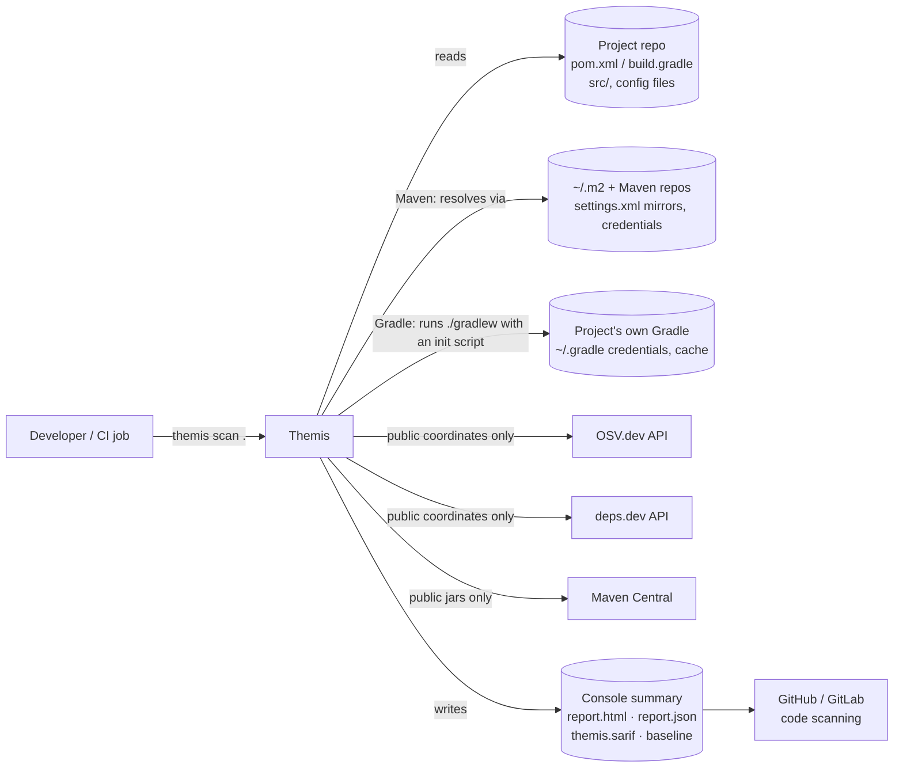
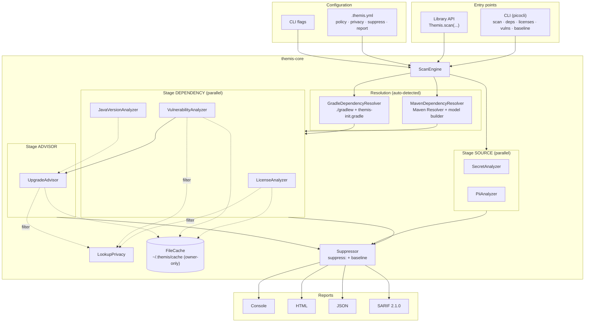
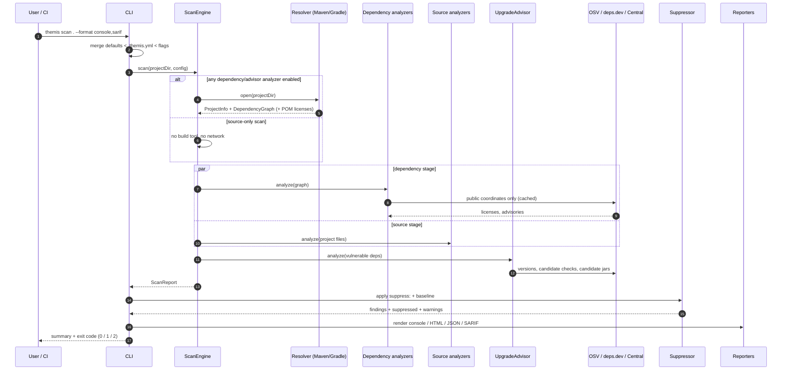
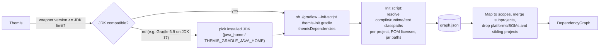
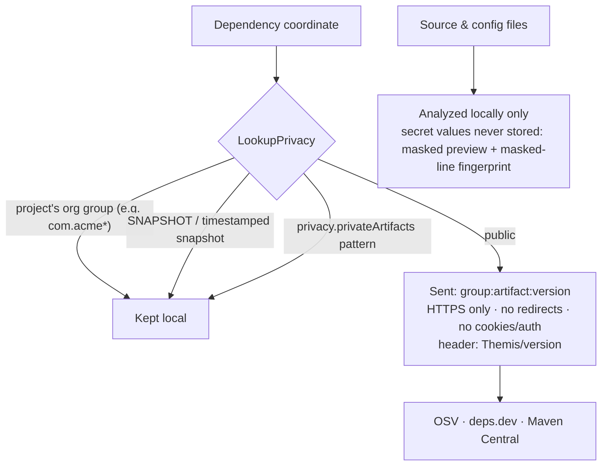

# Themis: High-Level Design

Status: v0.1 (implemented) · Scope: Java projects built with Maven or Gradle · Companion: [LLD.md](LLD.md)

## 1. Context

**Trust boundary.** Source code, config contents, file paths, project names and internal package names never leave the machine. Only `group:artifact:version` of public packages is sent to OSV / deps.dev / Maven Central, over HTTPS, without cookies or credentials. Resolving dependencies uses the user's own Maven/Gradle setup (their repositories and credentials), exactly as their build does.

## 2. Architecture

Themis is a **pipeline of independent analyzers** over a shared, read-only project model, run by a stage-aware engine. Reports are rendered from one `ScanReport`.

### Why this shape

- **Analyzers are independent**: each concern evolves separately and can be selected (`--only licenses,vulns`); one failing analyzer is reported as an error and never aborts the scan.
- **Resolvers are pluggable**: analyzers see a neutral `Dependency` model, so Maven and Gradle share every analyzer.
- **Stages express data flow**: dependency and source analyzers run in parallel; the upgrade advisor runs after them because it needs their results.
- **Source-only scans skip resolution**: `--only secrets,pii` never runs Maven/Gradle or touches the network.

## 3. Components

| Component | Responsibility | Key tech |
|---|---|---|
| **CLI** | Commands, flags, config merge, console output, exit codes, console-limit to HTML | picocli |
| **ScanEngine** | Open a project session, run stages, isolate analyzer failures, collect findings and data | `ExecutorService` |
| **Config** | `.themis.yml` (unknown keys are errors), precedence CLI > file > defaults | Jackson YAML |
| **MavenDependencyResolver** | Effective POMs (parents, BOMs, profiles, `${revision}`), reactor modules, mediation, scopes, settings.xml mirrors/proxies/credentials | Maven Resolver 1.9, maven-model-builder 3.9 |
| **GradleDependencyResolver** | Runs the project's Gradle with an init script that dumps resolved configurations as JSON; picks a compatible JDK for old Gradle | Gradle 6.9+ (init script), `java_home` |
| **LicenseAnalyzer** | POM licenses (with parents) -> deps.dev -> jar text; SPDX normalization; obligation categories; policy severities | SPDX alias table |
| **VulnerabilityAnalyzer** | Batch OSV queries, advisory details, CVSS v3 scoring, nearest fixed version | OSV API |
| **JavaVersionAnalyzer** | Class-file major version per jar (multi-release aware) | `JarFile` |
| **UpgradeAdvisor** | Lowest stable version with no known advisories whose bytecode runs on the project's Java | deps.dev versions, OSV, Maven Central |
| **SecretAnalyzer** | Known token formats, hardcoded config values, Java constants/setters/`@Value` defaults; masked previews only | regex rules, entropy, JavaParser |
| **PiiAnalyzer** | PII in logs, entities logged whole, `toString()` (Lombok, records, hand-written), exception messages | JavaParser, PII vocabulary |
| **LookupPrivacy** | Which coordinates may go to public APIs (never internal groups or snapshots) | patterns |
| **FileCache** | Cached network answers with TTL; owner-only permissions; enables `--offline` | JSON files |
| **Suppressor / Baseline** | `suppress:` entries (reason, expiry) and baselined finding ids | stable finding ids |
| **Reporters** | Console, JSON, self-contained HTML, SARIF 2.1.0 | Jackson, vanilla JS |

## 4. Main flow

## 5. Gradle resolution

Gradle's resolution (highest version wins, platforms, the Spring dependency-management plugin, repositories, credentials) cannot be reproduced outside Gradle, so Themis runs it:

## 6. Privacy model

Other guarantees: `~/.themis/cache` is owner-only (`rwx------`); `--offline` sends nothing; the HTML report loads nothing from the network (Content-Security-Policy `default-src 'none'`), renders all text as text (no `innerHTML`), and shows the home directory as `~`.

## 7. Key design decisions

| # | Decision | Rationale | Alternative rejected |
|---|---|---|---|
| D1 | Java 17, JVM-native | Maven Resolver, JavaParser and Gradle tooling are JVM libraries; target users run Java | Python: would shell out and parse text |
| D2 | Maven Resolver + model builder | Parents, BOMs, profiles, mediation done exactly like Maven (verified against `mvn dependency:list`) | Parsing pom.xml |
| D3 | Gradle via init script in the project's own Gradle | Only Gradle reproduces Gradle resolution; reuses the user's credentials and cache | Tooling API (heavier), re-implementing resolution |
| D4 | OSV as vulnerability source | Free, no key, Maven-native, batch endpoint, fixed versions | NVD: noisy CPE matching |
| D5 | Bytecode for Java compatibility | Class-file version is ground truth | Reading the library's build config |
| D6 | Licenses as SPDX + obligation category | One policy line per category (`NETWORK_COPYLEFT: HIGH`) | Free-text license names |
| D7 | Privacy filter before every network call | Internal package names are themselves sensitive | Sending everything |
| D8 | Secrets never stored | Reports get shared; a scanner must not become a leak | Storing values for dedup |
| D9 | Stable finding ids | Baselines and suppressions must survive version bumps and line moves | Ids with versions/line numbers |
| D10 | Self-contained HTML | Shareable, works offline, no supply chain in the report | CDN-based UI frameworks |

## 8. Outputs

| Output | When | Content |
|---|---|---|
| Console | default | Summary (project, dependencies, licenses, vulnerable deps, findings by severity, suppressed) and findings, or summary only above `report.consoleLimit` (default 25) |
| `report.html` | above the console limit, or `--format html` | Cards + tabs: Findings, Vulnerabilities, Upgrades, Secrets & PII, Licenses, Dependencies, Suppressed, Warnings; search, filters, sorting, details |
| `report.json` | `--format json` | Full machine-readable report (schemaVersion 1), including suppressed findings |
| `themis.sarif` | `--format sarif` | SARIF 2.1.0 for code scanning, file:line locations, fingerprints |
| `.themis-baseline.json` | `themis baseline` | Accepted finding ids (commit it) |
| Exit code | always | `0` nothing at/above `--fail-on` (default HIGH), `1` findings at/above it, `2` usage/config/resolution error |

## 9. Non-functional requirements

| Concern | Approach |
|---|---|
| Performance | Parallel analyzers; one OSV batch call per scan; caches (24 h for OSV, 30 days for licenses, forever for jar Java versions); source-only scans skip resolution |
| Offline | `--offline`: local repository / Gradle cache and Themis cache only |
| Reliability | Analyzer failures are reported, never abort the scan; OSV unreachable is an error, never "no vulnerabilities"; `--lenient` turns unresolvable dependencies into warnings |
| Security | XXE-safe POM parsing, HTTPS-only APIs without redirects, Maven HTTP-blocker mirror, `--ignore-pom-repositories` for untrusted code, no secret values in output |
| Accuracy | Prefer UNKNOWN over a wrong guess; every finding carries evidence and source |
| Portability | macOS/Linux/Windows; locale-independent parsing (tested under tr-TR) |

## 10. Risks and mitigations

| Risk | Mitigation |
|---|---|
| Gradle build scripts execute during resolution | Documented; source-only scans avoid it; resolve trusted repos only |
| Credentials sent to POM-declared repositories (Maven behaviour) | `--ignore-pom-repositories`; recommend `mirrorOf *` in CI |
| Secret/PII false positives | Placeholder and entropy checks, metadata-name filter, test downgrade, `themis:ignore`, `suppress:`, baseline |
| Public API rate limits | Batching, caching, bounded retries |
| "Compatible" upgrade still breaks APIs | Prefer same-major versions; flag major changes |

## 11. Roadmap

| Phase | Deliverable | Status |
|---|---|---|
| P1 | Maven dependency graph | Done |
| P1b | Gradle support, JDK selection, `--lenient` | Done |
| P2 | Licenses, SPDX, policy, `.themis.yml` | Done |
| P3 | OSV vulnerabilities, privacy filter | Done |
| P4 | Runtime-aware upgrade advisor, HTML report | Done |
| P5-6 | Secrets and PII | Done |
| P7 | Suppressions, baseline, SARIF | Done |
| P8 | Packaging and CI: release jar, GitHub Action / Jenkins snippet, Maven/Gradle plugin | Next |
