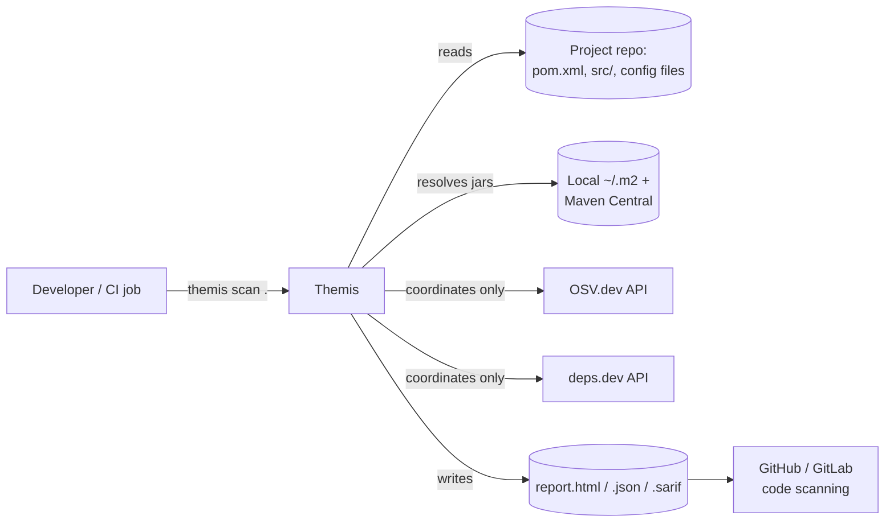
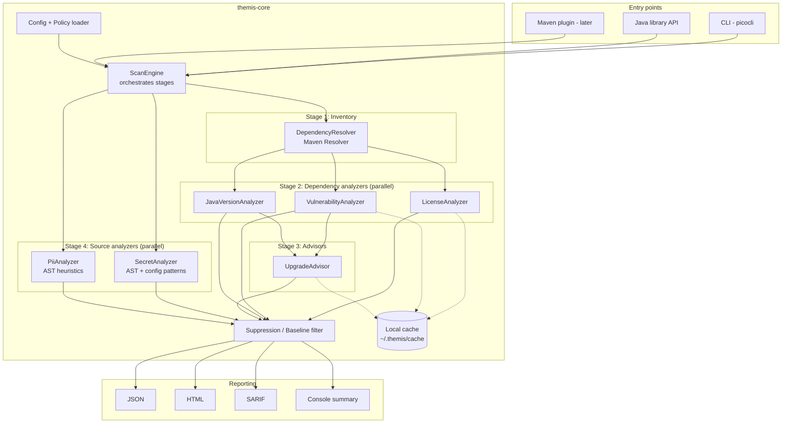
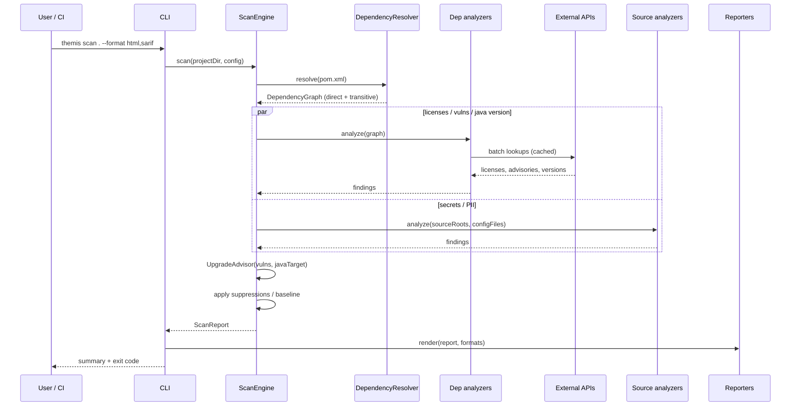

# Themis: High-Level Design

Status: Draft v0.1 · Scope: Java / Maven projects

## 1. Context

Only package coordinates (`groupId:artifactId:version`) leave the machine. Source code and config contents never do.

## 2. Architecture

Themis is a **pipeline of independent analyzers** over a shared, immutable project model. Each analyzer adds findings; the report layer renders them.

### Why a pipeline of analyzers

- Each concern (licenses, CVEs, secrets...) evolves independently and can be enabled or disabled (`--only licenses,vulns`).
- New ecosystems (Gradle, npm) only need a new `DependencyResolver`; analyzers work on a neutral `Dependency` model.
- Analyzers are pure functions of `(model, config) -> findings`, which makes them easy to test with fixtures.

## 3. Components

| Component | Responsibility | Key tech |
|---|---|---|
| **CLI** | Parse args, load config, invoke engine, print summary, set exit code | picocli |
| **ScanEngine** | Run stages in order, parallelize within a stage, collect results, apply suppressions | `ExecutorService` / virtual threads |
| **Config & Policy** | Load `.themis.yml`: license policy, severity thresholds, enabled analyzers, suppressions | Jackson YAML |
| **DependencyResolver** | Build the full resolved tree with scopes and paths ("pulled in via") | Maven Resolver (Aether), `maven-model-builder` |
| **LicenseAnalyzer** | POM `<licenses>` (walking parent POMs) then deps.dev fallback; normalize to SPDX; classify; evaluate policy | SPDX license list |
| **VulnerabilityAnalyzer** | Batch-query OSV for each `(ecosystem=Maven, name, version)`; map severity (CVSS) | OSV `/v1/querybatch` |
| **JavaVersionAnalyzer** | Open each jar, read class-file major version; handle multi-release jars | `java.util.zip`, `JarFile` |
| **UpgradeAdvisor** | Find the minimal version that fixes all advisories and is runtime-compatible | Maven metadata, OSV, JavaVersionAnalyzer |
| **SecretAnalyzer** | Known key formats, suspicious variable names + entropy, in `.java` (AST) and config files | JavaParser, regex rule set |
| **PiiAnalyzer** | PII-named fields/getters reaching loggers, `toString()`, response bodies | JavaParser (+ symbol solver later) |
| **Reporters** | Render one `ScanReport` into formats | Jackson, a template engine, SARIF 2.1.0 |
| **Cache** | Cache network lookups by coordinate + TTL; allows offline runs | file-based JSON |

## 4. Main flow

## 5. Key design decisions

| # | Decision | Rationale | Alternative rejected |
|---|---|---|---|
| D1 | Implement in **Java 17** | Best Java AST (JavaParser) and Maven resolver are JVM libraries; can ship as a Maven plugin; target users run Java | Python: would shell out to `mvn` and parse text; weaker Java parsers |
| D2 | Use **Maven Resolver**, not POM parsing | Parent POMs, BOMs, properties, `dependencyManagement`, mediation are hard to replicate correctly | Regex/XML parsing of `pom.xml` |
| D3 | **OSV.dev** as primary vulnerability source | Free, no API key, native Maven coordinates, batch endpoint, includes fixed versions | NVD: CPE matching is noisy for Maven |
| D4 | **Bytecode** for Java version | Class-file major version is ground truth | Reading `maven.compiler.target` of the library: often absent or wrong |
| D5 | Licenses classified by **obligation**, normalized to **SPDX** | Policy can be written once (`deny: [NETWORK_COPYLEFT]`) | Free-text license names |
| D6 | Only coordinates leave the machine | Required for use on proprietary code | Uploading SBOM/code to a SaaS |
| D7 | Multi-module: `core` (library) + `cli` | Core reusable by plugin and other tools; CLI stays thin | Single fat jar |

## 6. Outputs

- **Console**: counts per severity, top issues, path to the full report.
- **JSON**: complete machine-readable `ScanReport` (stable schema, versioned).
- **HTML**: single self-contained file; tables for licenses, vulnerabilities (with upgrade advice), Java compatibility, secrets/PII.
- **SARIF 2.1.0**: secrets/PII as code locations; dependency findings anchored to `pom.xml`.
- **Exit codes**: `0` clean, `1` policy violations found, `2` tool/config error.

## 7. Non-functional requirements

| Concern | Target / approach |
|---|---|
| Performance | < 30 s for ~250 deps with warm cache; parallel analyzers; batch API calls |
| Offline | `--offline` uses cache + local `~/.m2`; findings marked "stale" if cache is old |
| Privacy | No source upload; coordinates only; `--no-network` mode for air-gapped use |
| Reliability | One analyzer failing never aborts the scan; it is reported as an error section |
| Extensibility | Analyzers and resolvers via interfaces (and `ServiceLoader` later) |
| Accuracy | Prefer "UNKNOWN" over a wrong guess; every finding carries its evidence/source |

## 8. Risks

| Risk | Mitigation |
|---|---|
| Missing/ambiguous license metadata in POMs | Parent POM walk, deps.dev fallback, manual overrides in config |
| Secret/PII false positives | Allowlists, entropy thresholds, `@SuppressScan`, baseline file |
| API rate limits / outages | Batch queries, cache with TTL, graceful degradation |
| "Compatible" version still breaks API | Prefer same-major upgrades; later: binary compatibility check (japicmp) |

## 9. Roadmap

| Phase | Deliverable |
|---|---|
| P1 | CLI skeleton + Maven dependency graph (direct + transitive) |
| P2 | License detection, SPDX normalization, classification, policy |
| P3 | OSV vulnerabilities + fixed-version lookup |
| P4 | Bytecode Java version + runtime-aware UpgradeAdvisor |
| P5 | Secret scanning (config files + AST) |
| P6 | PII heuristics |
| P7 | HTML/SARIF reports, Gradle resolver, Maven plugin packaging |
