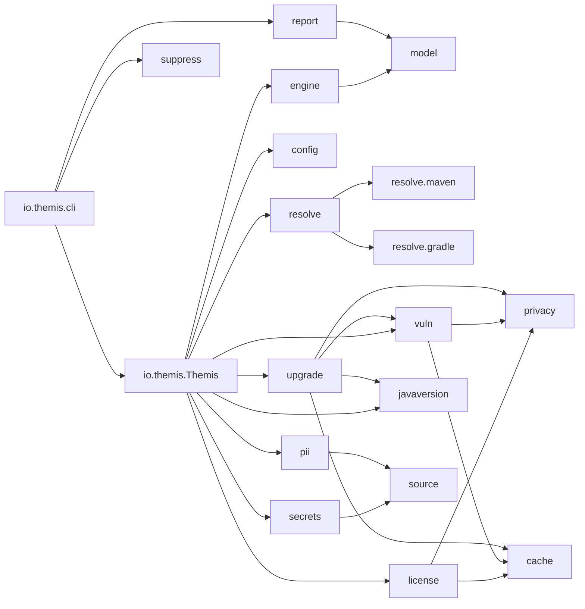
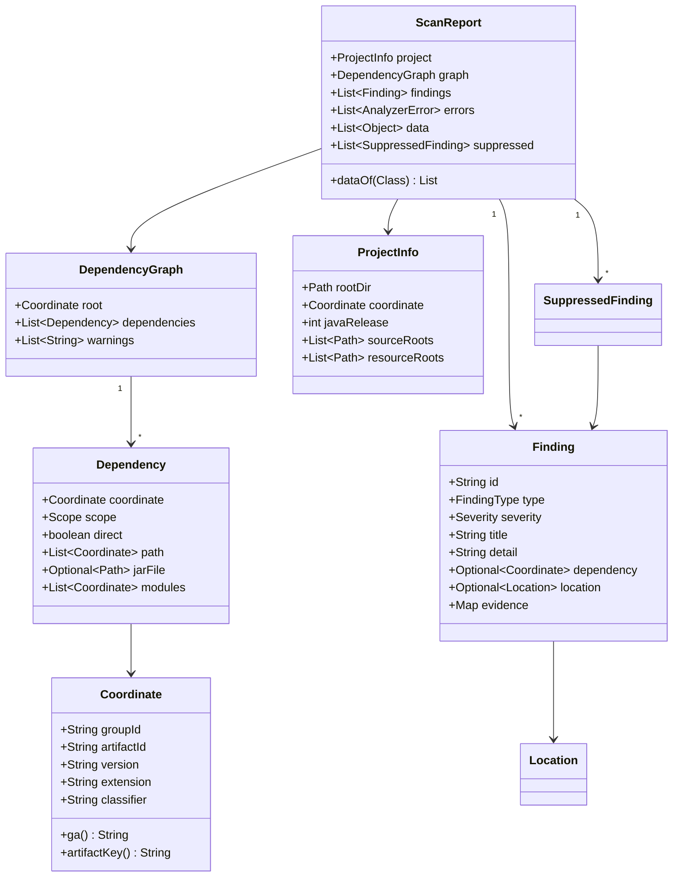
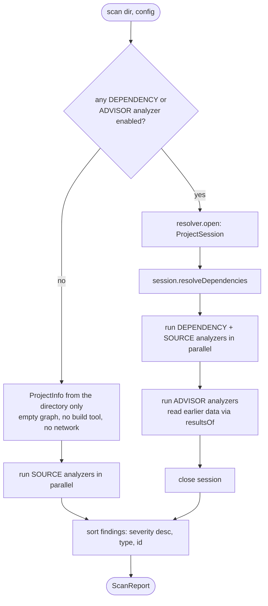
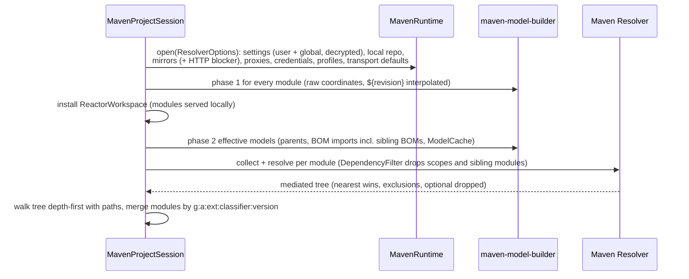
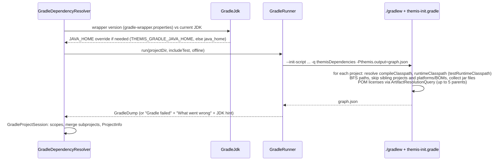
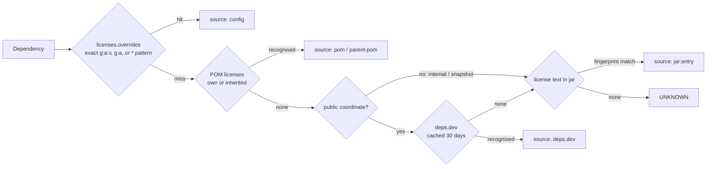
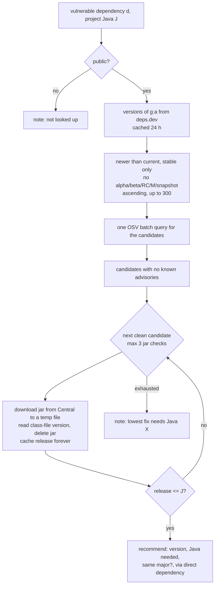
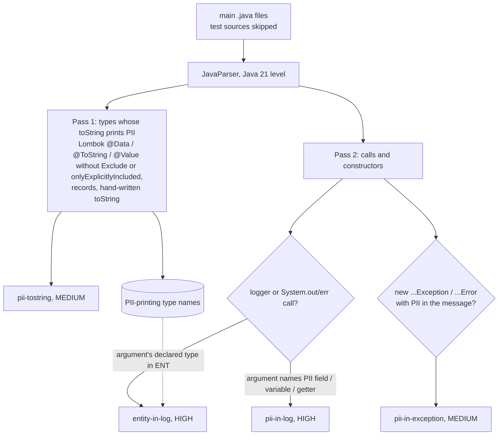
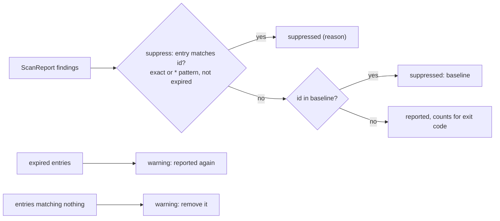

# Themis: Low-Level Design

Status: v0.1 (implemented) · Companion to [HLD.md](HLD.md) · Why: [WHY.md](WHY.md)

## 1. Modules and packages

```
themis/
├── pom.xml                           parent: Java 17, dependency versions
├── themis-core/                      the library (no CLI concerns)
│   └── io.themis
│       ├── Themis, Environment       entry point; machine-specific settings (Maven, Gradle, cache, API URLs)
│       ├── model/                    immutable records: Coordinate, Dependency, DependencyGraph, Finding, ScanReport...
│       ├── engine/                   ScanEngine, ScanContext, Analyzer, Stage, AnalyzerResult
│       ├── config/                   ScanConfig, ConfigLoader (.themis.yml), ConfigFile, LicensePolicy
│       ├── resolve/                  DependencyResolver SPI, ProjectSession, AutoDetectingResolver, JavaRelease
│       │   ├── maven/                MavenDependencyResolver, MavenRuntime, SettingsLoader, ReactorWorkspace, PomSafety...
│       │   └── gradle/               GradleDependencyResolver, GradleRunner, GradleJdk, GradleProjectSession, themis-init.gradle
│       ├── license/                  LicenseAnalyzer, LicenseLookup, SpdxNormalizer, LicenseClassifier, DepsDevClient
│       ├── vuln/                     VulnerabilityAnalyzer, OsvClient, Cvss, Advisory
│       ├── javaversion/              JavaVersionAnalyzer, ClassFileVersion
│       ├── upgrade/                  UpgradeAdvisor, JarFetcher, UpgradeSuggestion
│       ├── source/                   SourceFiles (project walker), SourceConfig
│       ├── secrets/                  SecretAnalyzer, Secrets (placeholders, entropy, masking)
│       ├── pii/                      PiiAnalyzer, PiiVocabulary
│       ├── privacy/                  LookupPrivacy, PrivacyConfig
│       ├── suppress/                 Suppressor, Suppression, Baseline
│       ├── cache/                    FileCache
│       └── report/                   JsonReportWriter, HtmlReportWriter (+ report.html), SarifReportWriter
├── themis-cli/                       picocli commands, packaged as a shaded runnable jar (themis.jar)
│   └── io.themis.cli                 ThemisCli, Scan/Deps/Licenses/Vulns/BaselineCommand, CliConfig, ReportOutput, Suppressions
└── docs/                             WHY, HLD, LLD
```

Rule: `cli` depends on `core`; `core` never depends on `cli`.



## 2. Domain model (`io.themis.model`)

All model types are Java records (immutable, value equality).



- `Scope`: `COMPILE, RUNTIME, PROVIDED, SYSTEM, TEST, IMPORT`; `Scope.widest(a, b)` with order compile > runtime > provided > system > test (used when merging modules).
- `Severity`: `INFO < LOW < MEDIUM < HIGH < CRITICAL`; `Severity.fromCvss(score)`: >= 9.0 CRITICAL, >= 7.0 HIGH, >= 4.0 MEDIUM, > 0 LOW.
- `FindingType`: `LICENSE, VULNERABILITY, JAVA_VERSION, UPGRADE, SECRET, PII`.
- Typed analyzer outputs travel in `ScanReport.data`: `LicenseInfo`, `DependencyVulnerabilities` (with `Advisory`), `JavaRequirement`, `UpgradeSuggestion`.

### Finding ids (stable: used by baselines and `suppress:`)

| Type | Id format |
|---|---|
| LICENSE | `LICENSE:<CATEGORY>:<group>:<artifact>` (no version: survives bumps) |
| VULNERABILITY | `VULNERABILITY:<advisory id>:<group>:<artifact>` |
| JAVA_VERSION | `JAVA_VERSION:requires-java-<N>:<group>:<artifact>` |
| UPGRADE | `UPGRADE:<group>:<artifact>` |
| SECRET | `SECRET:<rule>:<relative path>:<sha256 of the line with the secret masked, 12 hex>` |
| PII | `PII:<rule>:<relative path>:<field>:<hash of the trimmed line>` |

## 3. Engine (`io.themis.engine`)

```java
interface Analyzer {
    String name();                    // "licenses", "vulns", "javaversion", "upgrade", "secrets", "pii"
    Stage stage();                    // DEPENDENCY, SOURCE, ADVISOR
    AnalyzerResult analyze(ScanContext ctx) throws Exception;
}
record AnalyzerResult(List<Finding> findings, List<Object> data) {}
final class ScanContext {            // project(), graph(), config(), metadata(), resultsOf(Class)
}
```



Each analyzer runs in its own `Future`; an exception becomes an `AnalyzerError(name, message)` and the scan continues. The session stays open while analyzers run because the license analyzer reads POM licenses from it (`DependencyMetadata`).

## 4. Dependency resolution (`io.themis.resolve`)

```java
interface DependencyResolver {
    boolean supports(Path projectDir);
    ProjectSession open(Path projectDir, ScanConfig config);
}
interface ProjectSession extends DependencyMetadata, AutoCloseable {
    ProjectInfo project();
    DependencyGraph resolveDependencies();
    PomLicenses pomLicenses(Coordinate dependency);
}
```

`AutoDetectingResolver` picks the first resolver that supports the directory: Maven when `pom.xml` exists, otherwise Gradle when `settings.gradle[.kts]` or `build.gradle[.kts]` exists, otherwise a clear error.

### 4.1 Maven (`resolve.maven`)



- Scopes: compile, runtime, provided, system by default; test with `--include-test`.
- Each dependency carries its path from the declaring module, the declaring modules, and the resolved jar.
- Warnings use Maven's wording ("The POM for ... is missing, no dependency information available").
- `--lenient`: a `DependencyResolutionException` with a partial result becomes a warning; the partial graph is used.
- Security: `PomSafety` rejects DOCTYPEs in project POMs (XXE); the `external:http:*` blocker mirror is always installed; `--ignore-pom-repositories` resolves only from settings mirrors/profiles and Central.
- Transport defaults (overridable with `-D`): connect timeout 10 s, request timeout 60 s, 2 retries, max retry interval 20 s, User-Agent `Themis/<version>`.

### 4.2 Gradle (`resolve.gradle`)



Scope mapping per project: in compile and runtime classpaths = COMPILE; runtime only = RUNTIME; compile only (`compileOnly`, e.g. Lombok) = PROVIDED; test runtime only = TEST. Subprojects merge like Maven modules. A project without repositories (e.g. a root that only applies dependency management) is skipped with a warning.

JDK limits used by `GradleJdk.maxSupportedJdk`: Gradle 6.x and 7.0-7.2 = 16, 7.3-7.4 = 17, 7.5 = 18, 7.6 / 8.0-8.2 = 19, 8.3-8.4 = 20, 8.5-8.7 = 21, 8.8-8.9 = 22, 8.10-8.13 = 23, 8.14 = 24, 9 = 25.

## 5. Licenses (`io.themis.license`)



- `SpdxNormalizer`: bundled `aliases.tsv` (names and URLs) and the SPDX id list; matching lowercases, strips punctuation and noise words; multiple `<license>` entries combine with `OR`.
- `LicenseClassifier`: SPDX expression to category; `OR` takes the least restrictive option, `AND` the most restrictive; `GPL ... WITH Classpath-exception` = weak copyleft.
- `LicensePolicy` defaults: NETWORK_COPYLEFT HIGH, STRONG_COPYLEFT HIGH, PROPRIETARY MEDIUM, UNKNOWN LOW, WEAK_COPYLEFT INFO, PERMISSIVE no finding. Test scope capped at INFO; provided/system one level lower. `allowArtifacts` (with `*`) suppresses findings but keeps the data.

## 6. Vulnerabilities (`io.themis.vuln`)

1. Public coordinates (see section 11) not in the cache go to `POST /v1/querybatch` (up to 1000 per call); answers cached 24 h under `osv-query`.
2. Unique advisory ids not cached: `GET /v1/vulns/{id}`, 8 in parallel, cached 24 h under `osv-vuln`. Withdrawn advisories are ignored.
3. Severity: CVSS v3 base score computed from the vector (`Cvss`, FIRST spec formulas), else the database rating (GHSA `MODERATE` = MEDIUM), else MEDIUM. Test-scope findings capped at LOW.
4. Fixed version per advisory: smallest `fixed` event of the package's ECOSYSTEM ranges above the current version (`ComparableVersion`); per dependency: the version that fixes all advisories.
5. OSV unreachable = analyzer error, never "no vulnerabilities". `--offline` answers from the cache and marks the rest "not checked".

## 7. Java version (`io.themis.javaversion`)

`ClassFileVersion.scanJar`: read the first 8 bytes of every `.class` (magic `0xCAFEBABE`, minor, major), skip `module-info.class` and `META-INF/versions/**`, take the maximum major; release = major - 44. Multi-release jars report the base level. Finding when the release exceeds the project's (`JAVA_VERSION`, HIGH).

## 8. Upgrade advisor (`io.themis.upgrade`)



Findings: UPGRADE INFO with a recommendation ("Upgrade g:a 1.0 -> 1.2 (fixes 3 advisories; runs on Java 8+)"); MEDIUM when the only fixes need a newer Java; LOW when no clean version exists. For transitive dependencies the detail names the direct dependency (`path[1]`) and the override option (Maven `<dependencyManagement>`, Gradle constraints).

## 9. Secrets (`io.themis.secrets`)

Files: everything under the project root except build output, VCS/IDE folders, `node_modules`, files over 1 MB and `secrets.exclude` / `pii.exclude` globs (`SourceFiles`). Candidate files: `.properties .yml .yaml .env* .json .xml .conf .cfg .ini .toml .sh .gradle .kts .tf .tfvars .pem .key .sql .txt .java`, Dockerfiles, docker-compose.

```mermaid
flowchart TB
    LINE[each line] --> IGN{themis:ignore here<br/>or on the comment line above?}
    IGN -->|yes| SKIP[skip]
    IGN -->|no| KNOWN{known format?}
    KNOWN -->|yes| F1[finding: rule severity]
    KNOWN -->|no, config file| ASG{key = value with a secret-like key?<br/>password, token, api-key, client-secret...}
    ASG -->|no| SKIP
    ASG -->|yes| REAL{"looks real?<br/>length >= 8, no spaces, entropy >= 3.0,<br/>not placeholders: $&#123;...&#125; $VAR &#123;&#123;...&#125;&#125; ENC(...) changeme"}
    REAL -->|yes| F2[generic-secret-assignment, HIGH]
    REAL -->|no| SKIP
    JAVA[.java files] --> AST[JavaParser: secret-named constants with literals,<br/>setPassword-style calls with literals,<br/>@Value defaults with secret keys]
    AST --> F3[java-hardcoded-secret / spring-value-default-secret, HIGH]
```



| Rule | Detects | Severity |
|---|---|---|
| `private-key` | `-----BEGIN ... PRIVATE KEY-----` | CRITICAL |
| `aws-access-key` | `AKIA`/`ASIA` + 16 | CRITICAL |
| `github-token` | `ghp_`/`gho_`/... and `github_pat_` | CRITICAL |
| `stripe-live-key` | `sk_live_` / `rk_live_` | CRITICAL |
| `slack-token`, `slack-webhook` | `xox?-...`, hooks.slack.com | HIGH |
| `google-api-key` | `AIza` + 35 | HIGH |
| `jwt` | three base64url segments starting `eyJ` | HIGH |
| `url-credentials`, `jdbc-password` | `scheme://user:pass@`, `;password=` | HIGH |
| `generic-secret-assignment` | config `key=value` | HIGH |
| `java-hardcoded-secret`, `spring-value-default-secret` | Java AST | HIGH |

Test files: LOW. Output: masked preview (`AKIA****LE`) and a fingerprint of the line with the secret masked out; the value itself is never stored, logged or written.

## 10. PII (`io.themis.pii`)

`PiiVocabulary` matches whole tokens of camelCase/snake_case identifiers: email, phone/mobile/telephone/contact number, msisdn, aadhaar, PAN, date of birth/DOB, address, pincode/zip/postal code, passport, SSN, card number, account number, UPI/VPA, IFSC, CVV, GSTIN, voter id, driving licence, IP address, first/last/full name. Names containing metadata tokens (id, template, count, type, flag, verified, hash, encrypted, masked, dto, service...) are not PII (`emailTemplateId`, `emailVerifiedFlag`). `pii.extraFields` adds exact identifiers, `pii.ignoreFields` removes them.



Logger detection: receiver named `log`, `logger`, `*logger`, `*_log` with methods trace/debug/info/warn/error/fatal (and JUL levels). Entity types are resolved from parameters, local variables and fields of the enclosing method/class (simple names, no cross-file type solving).

## 11. Privacy (`io.themis.privacy`)

`LookupPrivacy.of(PrivacyConfig, projectCoordinate)`:
- private: the project's organisation group (first two groupId segments: `com.acme` covers `com.acme:*` and `com.acme.*`, not `com.acmex`), when `privacy.projectGroupPrivate` (default true);
- private: `-SNAPSHOT` and timestamped snapshot versions (`-20230310.055002-1`);
- private: `privacy.privateArtifacts` patterns;
- everything else may be sent.

Applies to deps.dev license lookups, OSV queries, deps.dev version lists and Central jar downloads. HTTP clients: HTTPS only (loopback allowed for tests), redirects never followed, no cookies or credentials, headers limited to the Themis client name, `Accept`, `Content-Type`; `HTTPS_PROXY` and JVM proxy properties honoured.

## 12. Suppressions and baseline (`io.themis.suppress`)



- `.themis.yml`: `suppress: [{id, reason (required), until (date, optional)}]`.
- `themis baseline [DIR] [--file F]` writes `.themis-baseline.json` (`schemaVersion`, `createdAt`, `tool`, `project`, sorted `findings[{id, severity, title}]`). `scan` applies it by default (`--baseline F`, `--no-baseline`).
- Suppressed findings remain in JSON (`suppressed[]`) and HTML (Suppressed tab).

## 13. Configuration (`.themis.yml`)

```yaml
javaRelease: 17                      # override detection
analyzers: [licenses, vulns, javaversion, upgrade, secrets, pii]
failOn:
  severity: HIGH                     # exit 1 at or above
licenses:
  severity: {NETWORK_COPYLEFT: HIGH, STRONG_COPYLEFT: LOW, WEAK_COPYLEFT: NONE}
  overrides:
    "com.acme*": "LicenseRef-Acme-Proprietary"
  allowArtifacts: ["com.mysql:*"]
network:
  offline: false
  cacheTtlHours: 24
privacy:
  privateArtifacts: ["io.vendor.internal:*"]
  projectGroupPrivate: true
secrets:
  exclude: ["legacy/**"]
pii:
  exclude: ["generated/**"]
  extraFields: [customerId]
  ignoreFields: [maskedPhone]
report:
  consoleLimit: 25
  open: true
suppress:
  - id: "VULNERABILITY:GHSA-*:com.mysql:*"
    reason: "Driver only used by an internal batch job"
    until: 2027-03-31
```

Precedence: CLI flags > `--config FILE` or the project's `.themis.yml` > defaults. Unknown keys, bad severities, negative TTLs and suppressions without a reason are errors (exit 2) naming the key and line.

## 14. CLI (`themis-cli`)

```
themis scan [DIR]       --format console,json,html,sarif  --output DIR  --only a,b  --fail-on SEVERITY
                        --console-limit N  --no-open  --baseline FILE  --no-baseline
                        --java-release N  --offline  --include-test  --lenient  --config FILE
                        -s/--settings FILE  --ignore-pom-repositories
themis deps [DIR]       --include-test --offline --lenient -s --ignore-pom-repositories
themis licenses [DIR]   --include-test --offline --lenient --config --console-limit --no-open --output
themis vulns [DIR]      (same as licenses)
themis baseline [DIR]   --file FILE --only --include-test --offline --lenient --config
themis --version | help
```

Exit codes: `0` no reported finding at or above `--fail-on` (default HIGH, or `failOn.severity`); `1` findings at or above it; `2` usage, configuration or resolution error. Environment: `THEMIS_GRADLE_JAVA_HOME`, `-Dthemis.cache.dir`, `HTTPS_PROXY`.

Console limit: when `scan` findings (or `vulns`/`licenses` rows) exceed `report.consoleLimit` (default 25, `--console-limit`), the console shows the summary only and `report.html` is written and opened (interactive terminals only; never when `CI` is set or with `--no-open`).

## 15. Reports (`io.themis.report`)

| Writer | File | Notes |
|---|---|---|
| `JsonReportWriter` | `report.json` | `schemaVersion: 1`, tool, project, summary, dependencies (with license), findings, errors, warnings, suppressed |
| `HtmlReportWriter` | `report.html` | template `report.html`; data embedded as script-safe JSON (`< > &` and line separators escaped); DOM text nodes only; links only for `https://`; CSP `default-src 'none'`; home directory shown as `~` |
| `SarifReportWriter` | `themis.sarif` | SARIF 2.1.0 (validated against the OASIS schema); rule ids: advisory id, `license/<category>`, `secret/<rule>`, `pii/<rule>`, `java-version`, `upgrade`; levels error/warning/note; `security-severity` (CVSS when known); dependency findings located at the declaring line of pom.xml / build.gradle[.kts] (transitive: the direct dependency's line); `partialFingerprints.themisFindingId/v1` |

## 16. Caching (`io.themis.cache`)

`~/.themis/cache/<namespace>/<sha256(key)>.json` = `{storedAt, key, value}`; directories `rwx------`, files `rw-------`; atomic writes.

| Namespace | Key | TTL |
|---|---|---|
| `license` | `g:a:v` (deps.dev licenses) | 30 days |
| `osv-query` | `g:a:v` (advisory ids) | 24 h |
| `osv-vuln` | advisory id | 24 h |
| `upgrade-versions` | `g:a` | 24 h |
| `javaversion` | `g:a:v` (release of a candidate jar) | 10 years (released jars are immutable) |

`network.cacheTtlHours` overrides the TTLs; `--offline` reads the cache only.

## 17. Testing strategy

| Level | What |
|---|---|
| Unit | SPDX normalization and classification, CVSS scores, class-file versions, PII vocabulary, privacy rules, Gradle JDK matrix, suppression matching, config parsing (incl. tr-TR locale) |
| Component | Maven resolver against an on-disk fixture repository (mediation, BOMs, scopes, classifiers, multi-module, `${revision}`, settings, offline); Gradle resolver against a real local Gradle with fixture repos; analyzers with stub HTTP servers |
| Privacy | Stub servers record every path, header and body: tests assert no internal coordinates, snapshots, paths or project names are sent |
| Report safety | HTML: no external resources, CSP present, hostile advisory text stays inert; SARIF validated |
| CLI | Hermetic `Environment` (fixture settings, temp cache, stub APIs): commands, exit codes, config precedence, baseline flow |
| Network (opt-in) | `-Pnetwork`: real Maven Central resolution |
| Manual | Real services (Maven and Gradle 6.9 / 7.6 / 8.x), Spring PetClinic, deliberately vulnerable samples (Log4Shell, snakeyaml, jackson) |
