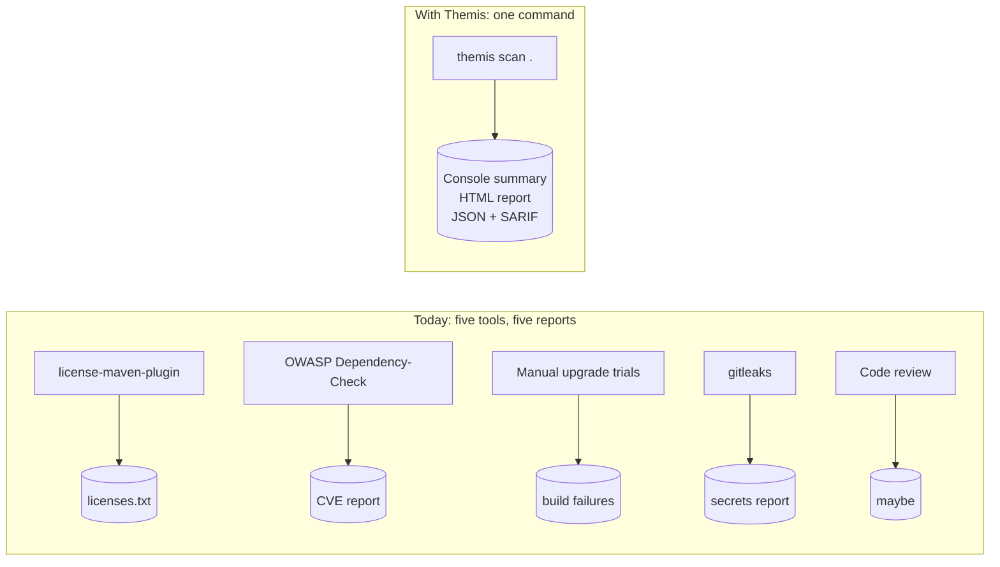
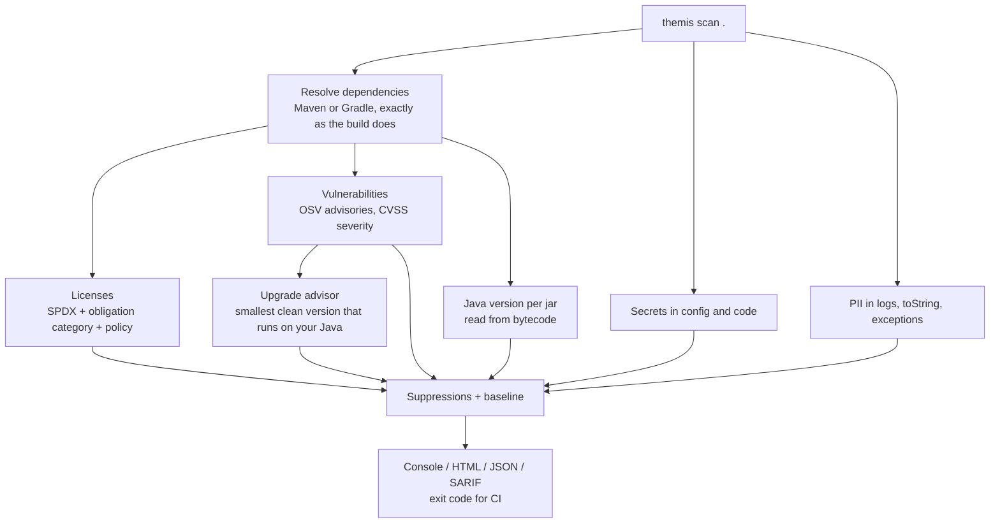

# Why Themis?

> One command that tells a Java team **what it depends on, what it is legally obliged to do because of it, what is vulnerable, how to fix it without breaking its Java version, and whether its own code leaks secrets or personal data**.

**About the name.** Themis is the Greek goddess of divine law, order and justice, usually shown holding the scales of judgement. The tool does the same job for a codebase: it weighs every dependency and every source file against the rules (license obligations, security advisories, runtime compatibility, data-protection hygiene) and delivers a verdict.

## 1. The problem

A typical Spring Boot service declares 20-40 dependencies. After transitive resolution it ships **150-300 jars**. Nobody on the team has read most of their licenses, nobody knows which have known CVEs today, and nobody is sure the code never logs a customer's phone number.

The questions that keep coming up:

| Question | Who asks | How it is answered today |
|---|---|---|
| "Are we allowed to use this library commercially?" | Legal, tech leads, due diligence | Someone opens each project's GitHub page by hand |
| "Are we affected by the new CVE in X?" | Security, on-call | `mvn dependency:tree \| grep`, `./gradlew dependencies`, reading advisories |
| "Which version fixes it, and will it run on our Java 17?" | The developer who has to fix it | Trial and error: bump, build, see what breaks |
| "Did someone commit an API key?" | Security | Code review, if the reviewer notices |
| "Are we logging customer PII?" | Compliance (DPDP Act, GDPR) | Nobody knows until it shows up in a log search |

Each question has some tool, but they are separate tools with separate reports, and none answers **the safe upgrade that is compatible with our runtime**.

## 2. Real costs of not knowing

- **License risk.** One AGPL or SSPL dependency in a SaaS backend can oblige you to publish source code. A dependency with *no* declared license is technically "all rights reserved". These are discovered late: acquisition due diligence, enterprise customer audits, open-sourcing.
- **Transitive vulnerabilities.** Log4Shell (CVE-2021-44228) hit many teams through libraries they never declared. Direct dependencies are the easy part; the risk lives in the tree.
- **Upgrade paralysis.** Advisories say "fixed in 2.17.1", not whether 2.17.1 needs a newer JDK. Teams postpone upgrades because the cost is unknown.
- **Leaked secrets.** A password in `application.yml` committed once is in git history forever and must be treated as compromised.
- **PII in logs.** `log.info("{}", customer)` on a Lombok `@Data` entity prints email, phone and PAN into every log pipeline. Cheap to catch statically, expensive to clean up in production.

## 3. What Themis does

1. **Inventory**: the full dependency graph (direct + transitive) of Maven and Gradle builds, multi-module included, using the build tool's own resolution.
2. **Licenses**: detect, normalize to SPDX, classify by obligation (permissive, weak/strong/network copyleft, proprietary, unknown), apply a configurable policy.
3. **Vulnerabilities**: OSV advisories for the exact resolved versions, with CVSS-based severity and fixed versions.
4. **Upgrade advice**: the *smallest* upgrade that fixes all known vulnerabilities **and** runs on the project's Java release; for transitive dependencies, which direct dependency to bump.
5. **Runtime compatibility**: the minimum Java version each jar needs, read from class files.
6. **Secrets**: known token formats and hardcoded passwords in config files and Java code; values are never stored, only masked previews.
7. **PII**: personal data written to logs, printed by `toString()`, or put into exception messages.
8. **CI-ready**: suppressions with reasons and expiry dates, a baseline so only *new* findings fail the build, SARIF for pull-request annotations, exit codes.

## 4. Who it is for

- **Developers**: run locally before a PR; get a concrete "bump X from a to b" list and file:line for secrets/PII.
- **CI pipelines**: fail on policy violations (any AGPL, any CRITICAL CVE, any hardcoded secret), annotate pull requests via SARIF.
- **Tech leads / security**: one HTML report per service.
- **Legal / compliance**: a license inventory on demand; evidence that PII is not logged.

## 5. Goals

- **Accuracy**: Maven Resolver and Gradle's own resolution, not hand-rolled parsing. Verified identical to `mvn dependency:list` on edge-case projects.
- **Zero config**: `themis scan .` gives a useful result; `.themis.yml` tunes it.
- **Privacy by design**: source code never leaves the machine; only public `group:artifact:version` coordinates go to public APIs; internal packages and snapshots are never sent.
- **Low noise**: placeholders are not secrets, metadata names are not PII, test code is downgraded, suppressions and baselines keep CI green on legacy services.
- **Usable everywhere**: library API, CLI, and CI (exit codes, SARIF).

## 6. Non-goals (for now)

- Legal advice. Themis classifies and flags; humans decide.
- Full data-flow (taint) analysis for PII. Heuristics on the syntax tree, tuned for low noise.
- Ecosystems other than Java (npm, pip, Go).
- Auto-applying upgrades or opening PRs.

## 7. How it compares

| Tool | Licenses | CVEs | Safe upgrade for your Java | Java version per jar | Secrets | PII | Gradle + Maven |
|---|---|---|---|---|---|---|---|
| OWASP Dependency-Check | - | Yes | - | - | - | - | Yes |
| license-maven-plugin | Yes | - | - | - | - | - | Maven |
| Snyk / Trivy | Yes | Yes | Partial | - | Partial | - | Yes |
| gitleaks | - | - | - | - | Yes | - | n/a |
| **Themis** | **Yes** | **Yes** | **Yes** | **Yes** | **Yes** | **Yes** | **Yes** |

The differentiators: one combined report, **runtime-aware upgrade suggestions**, **PII exposure detection**, and **strict privacy** (nothing about your code or internal packages leaves the machine).

## 8. Success criteria

- A typical Spring Boot service (about 250 dependencies) scans in under 30 seconds with a warm cache; source-only scans (`--only secrets,pii`) in a few seconds.
- License detected for at least 95% of public dependencies; the rest explicitly `UNKNOWN`.
- Every recommended upgrade has bytecode compatible with the project's Java release.
- False-positive rate low enough that teams keep it enabled in CI after a month (measured by suppressions added per scan).
